# YiziVoice



[简体中文](./README.md) | [English](./README.en.md)

**Website:** https://voice.yizigpt.com

YiziVoice is a cross-platform desktop voice studio built around **sound**. One piece of text, one recording — and you get text-to-speech, voice cloning, and speech-to-text in a single workspace where the three feed each other. No more hopping between tools and shuttling files.

- **Windows**: NSIS installer, double-click, no admin rights needed
- **macOS**: universal DMG, native on Intel and Apple Silicon
- **Linux**: Debian `deb` plus portable `AppImage` (AMD64)

Why YiziVoice? Dubbing has always been: write a script → find a voice actor → wait → listen → dislike it → redo. Existing TTS tools sound stiff, lock exports behind subscriptions, or make cloning hard. After Xiaomi open-sourced the MiMo family, Chinese expressiveness, emotional reading, and voice cloning all jumped a level — so we built YiziVoice around three promises: **natural sound**, **zero friction**, **local data**.

It packs `3 core abilities`, `9 preset voices`, `12 preset styles`, `3 style-writing modes`, and `1 manageable voice library` — in a ~10MB installer. Write a script, hear the finished dub in minutes. Don't like it, switch style and regenerate. Dubbing becomes a closed loop.

---

## Three abilities: text in, sound out; sound in, text out


TTS, voice cloning, and STT share one workspace, one voice library, one history. Clone a voice on the left, use it to read on the right. Generated audio can be downloaded or restored into the task for another iteration.

| Ability | In one line | Entry | Great for |
|---------|-------------|-------|-----------|
| **Text-to-Speech** | Type text, pick a voice, generate | `Ctrl+2` | Short videos, audiobooks, courseware |
| **Voice Cloning** | 20s sample → a reusable voice role | `Ctrl+1` | Recurring shows, personal IP, batch dubbing |
| **Speech-to-Text** | Record or upload → transcript | `Ctrl+3` | Meeting notes, interviews, draft subtitles |

### Text-to-Speech: script in, voice out

- 9 preset voices out of the box (5 Chinese + 4 English); cloned voices join the list anytime
- Three style-writing modes — one instruction per run, never conflicting:
  - **Audio-tag control**: 12 style chips + opening tag `(style)` + inline tag `[effect]`; custom tags editable
  - **Paragraph description**: describe speed, mood, age in plain language; AI expands it
  - **Director mode**: role / scene / direction — maps to MiMo's director API
- **AI style description**: type a keyword ("exam boy", "PR director"), the model fills in the full description without touching your script
- Play and download WAV right after generation; results share the scroll area with settings

### Voice Cloning: your voice, on call

- Three capture modes: **Record** (≤20s) / **Upload** (WAV/MP3/WebM/OGG/FLAC, ≤10MB) / **Design** (describe in text)
- Design mode needs no sample: describe the voice, the model synthesizes a new one; preview text can be auto-generated
- Role management: naming, categories (8 built-in, editable), AI-generated descriptions
- **Export / import JSON**: hand your voice library to a collaborator; they import and go

### Speech-to-Text: what was said, written down

- Record or upload; auto-detects Chinese, English, and dialects, or pin a language
- Copy or edit the transcript; recordings are kept for replay and download
- Shares history with TTS — drop a cleaned-up script straight into TTS

### Shared by all three

- **History & restore**: every generation is archived. Hit "restore task" to load the exact mode, style, script, and audio back into the workbench
- **Style control**: 12 presets + custom chips
- **Local & secure**: data in `Documents/YiziVoice/`; API key lives only in the OS credential store (Windows Credential Manager / macOS Keychain / Linux Secret Service) — **never plaintext, never uploaded, no telemetry**

---

## Preset voices

| Language | Voices | | Language | Voices |
|----------|--------|-|----------|--------|
| Chinese | MiMo-Default · BingTang · MoLi | | English | Mia · Chloe |
| Chinese | SuDa · BaiHua | | English | Milo · Dean |

A factory demo library (fictional personas such as Lingling, Shanshan) is included — preview it on the clone page, or replace it with your own voices.

---

## Install

Download from [GitHub Releases](https://github.com/laoduu/YiziVoice/releases) (a domestic mirror is on the [website](https://voice.yizigpt.com)).

| Platform | Artifact | Install |
|----------|----------|---------|
| **Windows** | `YiziVoice_<ver>_x64-setup.exe` | Double-click, follow the wizard |
| **macOS** | `YiziVoice_<ver>_universal.dmg` | Drag to Applications. If Gatekeeper blocks: right-click → Open, or `xattr -cr /Applications/YiziVoice.app` |
| **Linux** | `YiziVoice_<ver>_amd64.deb` | `sudo apt install ./YiziVoice_<ver>_amd64.deb` |
| **Linux** | `YiziVoice_<ver>_amd64.AppImage` | `chmod +x` and run (experimental, needs libfuse2) |

---

## Quick start

1. Launch YiziVoice → **Settings** → paste your MiMo API Key → Save
2. Pick an ability on the left (`Ctrl+1/2/3` to switch)
3. Type or record → generate → preview / download / restore

### Get an API Key & billing

Register at the [MiMo console](https://platform.xiaomimimo.com/console/balance). Invite code `DHLC96` gives bonus credit.

| Capability | Billing |
|-----------|---------|
| MiMo-TTS family (TTS / clone / design) | **Free** |
| MiMo-ASR (speech-to-text) | Paid, needs balance |
| MiMo-2.6 text models (AI style descriptions) | Paid, needs balance |

**Key security**: stored only in the OS credential store; settings page writes but never echoes. See [SECURITY.md](./SECURITY.md).

---

## Shortcuts

| Shortcut | Action | Shortcut | Action |
|----------|--------|----------|--------|
| `Ctrl+1` | Voice Clone | `Ctrl+L` | Toggle left pane |
| `Ctrl+2` | Text-to-Speech | `Ctrl+R` | Toggle right pane |
| `Ctrl+3` | Speech-to-Text | `Ctrl+F` | Search history |
| `Ctrl+,` | Settings hub | `Esc` | Close dialog / settings |

---

## Project structure

```
YiziVoice/
├── src/                  # React frontend
│   ├── pages/            # TTS / Voice Clone / STT
│   ├── components/       # layout, ui/, hub/ settings
│   └── services/         # API, config, history, desktop bridge
├── src-tauri/            # Tauri 2 Rust shell
│   ├── src/cmds/         # 36 commands (config/voices/styles/tags/history/settings/storage/export)
│   └── src/secrets.rs    # API key → OS credential store
├── docs/                 # dev / design / releasing / pitfalls
├── default-config/       # factory presets (voices / styles / tags)
├── scripts/              # gates: csp:check / design:check / release:check
├── website/              # landing page
└── .github/workflows/    # CI & release pipelines
```

---

## Tech stack

| Layer | Tech |
|-------|------|
| Desktop | Tauri 2 (Rust) |
| Frontend | React 18 + TypeScript |
| Styling | Tailwind CSS + liquid-glass material system |
| API | OpenAI-compatible SDK (locked to `api.xiaomimimo.com`) |
| Secrets | OS keyring (DPAPI / Keychain / Secret Service) |
| Build | Vite 5 |

---

## Development

### Prerequisites

- Node.js 18+
- Rust (stable)
- Windows: Visual Studio Build Tools ("Desktop development with C++"); Linux: `libwebkit2gtk-4.1-dev` etc.

### Run

```bash
npm install
npm run tauri:dev
```

### Pre-PR gates

```bash
npx tsc --noEmit        # type check
npm run csp:check       # CSP allowlist consistency
npm run design:check    # design-system static gate
cargo test --manifest-path src-tauri/Cargo.toml
```

> ⚠️ **CSP is only enforced in packaged builds** — `tauri dev` injects no CSP. Changes touching downloads/resources must be verified in a packaged build.

### Build releases

```bash
npm run tauri:build                                      # Windows NSIS
npm run tauri:build -- --target universal-apple-darwin   # macOS DMG
npm run tauri:build -- --bundles deb,appimage            # Linux
```

More: [docs/development.md](./docs/development.md) · [docs/architecture.md](./docs/architecture.md).

---

## Documentation

| Doc | Content |
|-----|---------|
| [docs/development.md](./docs/development.md) | Dev setup, layout, gate scripts |
| [docs/architecture.md](./docs/architecture.md) | Architecture, desktop bridge, data dirs |
| [docs/design-system.md](./docs/design-system.md) | Design system v4 (single source of truth) |
| [docs/pitfalls.md](./docs/pitfalls.md) | Pitfalls (CSP / keyring / StrictMode / WebKitGTK) |
| [docs/releasing.md](./docs/releasing.md) | Packaging & release checklist |
| [docs/faq.md](./docs/faq.md) | FAQ |
| [CHANGELOG.md](./CHANGELOG.md) | Changelog (Chinese) |

---

## Contributing

Issues and PRs welcome! Please read [CONTRIBUTING.md](./CONTRIBUTING.md). Security reports: [SECURITY.md](./SECURITY.md).

## License

[MIT License](./LICENSE) · Third-party notices: [THIRD_PARTY_NOTICES.md](./THIRD_PARTY_NOTICES.md)

## Acknowledgements

- [Xiaomi MiMo](https://platform.xiaomimimo.com) models — the foundation of Chinese expressiveness and voice cloning
- [Tauri](https://tauri.app) / [React](https://react.dev) / [Vite](https://vite.dev) / [Tailwind CSS](https://tailwindcss.com) / [lucide](https://lucide.dev)
- Everyone who tries the app, gives feedback, or sends a PR

---

If this project helps you, please consider a Star ⭐
