# YiziVoice



[简体中文](./README.md) | [English](./README.en.md)

**官方网站：** https://voice.yizigpt.com

YiziVoice 是一款以「声音」为中心的跨平台桌面语音工具。一段文案、一段录音，就能完成 `文生音`、`音色克隆`、`音转文`——三种能力在同一个工作台里彼此衔接，不用再来回切工具、传文件。

- **Windows**：NSIS 安装包，双击安装，免管理员权限
- **macOS**：通用二进制 DMG，Intel 与 Apple Silicon 均原生运行
- **Linux**：Debian 系 `deb` 与免安装 `AppImage`（AMD64）

为什么做 YiziVoice？配音这件事，长期以来的流程是：写稿 → 找配音 → 等档期 → 听效果 → 不满意 → 再改再配。市面上的 TTS 工具，要么声音生硬，要么导出要会员，要么克隆门槛高。小米 MiMo 系列开源之后，中文表现力、多情感朗读、声音克隆都上了一个台阶——于是便有了 YiziVoice，并坚持三件事：**声音自然**，**上手简单**，**数据本地**。

它覆盖 `3 种核心能力`、`9 个预置音色`、`12 种预设风格`、`3 种风格写法`、`1 个可管理的音色库`，安装包只有 **10MB** 出头。写完稿立刻听到成品配音，不满意就换个风格再生成——配音这件事，可以变成几分钟内完成的闭环。

---

## 三大能力：文本进去声音出来，声音进去文字出来


文生音、音色克隆、音转文共享同一个工作台、同一套音色库、同一份历史记录。左边克隆好的声音，右边就能用来朗读；朗读生成的音频，一键下载或还原任务继续改。

| 能力 | 一句话定位 | 入口 | 适合 |
|------|-----------|------|------|
| **文生音** | 输入文案，选音色，一键生成语音 | `Ctrl+2` | 短视频配音、有声书、课件朗读 |
| **音色克隆** | 20 秒样本复刻声音，存为可复用角色 | `Ctrl+1` | 固定栏目、个人 IP、批量配音 |
| **音转文** | 录音或上传音频，自动转成文字 | `Ctrl+3` | 会议记录、采访整理、字幕初稿 |

### 文生音：写完稿，立刻听到声音

- 9 个预置音色开箱即用（中文 5 + 英文 4），克隆音色可随时加入候选
- 三种风格写法，同一时间只发一种指令，不会互相打架：
  - **音频标签控制**：12 种预设风格胶囊 + 开场风格标签 `(风格)` + 内嵌标签 `[音频效果]`，自定义标签可增删改
  - **一段话描述**：用自然语言说清语速、情绪、年龄，AI 扩展为详细风格指令
  - **导演演绎**：角色 / 场景 / 指导三栏，贴合 MiMo 导演模式 API
- **AI 生成风格描述**：填几个关键字（如「考试少年」「公关总监」），模型补全完整描述，只动生成风格不动正文
- 生成完成即可播放、下载 WAV；结果与设置同滚动区，小窗口也放得下

### 音色克隆：你的声音，随时待命

- 三种采集方式：**开始录音**（20 秒内）/ **上传文件**（WAV/MP3/WebM/OGG/FLAC，≤10MB）/ **设计音色**（纯文字描述生成）
- 设计音色不需样本：描述音色特质，模型直接合成一个新声音，试听文本可自动生成
- 角色管理：命名、分类（内置 8 类，可增删）、AI 生成描述与试听文本
- **导出 / 导入 JSON**：把音色库打包发给协作者，对方导入即用，无需重新录制

### 音转文：说了什么，落成文字

- 录音或上传，自动识别中文、英文及方言口音，也可指定语言
- 转写结果可复制、可编辑；录音来源的音频会一并保存，可回放、下载
- 与文生音共用历史记录，整理好的文字稿直接粘进文生音继续用

### 共享能力：三大能力同享

- **历史与还原**：每次生成自动存档，左侧栏随时翻。点「还原任务」，把当时的模式、风格、文案、音频完整装回工作台——改一改再生成，不用从头填
- **风格控制**：12 种预设 + 自定义，胶囊式选择，所见即所得
- **本地与安全**：数据全在 `文档/YiziVoice/`，API Key 只进系统钥匙串（Windows 凭据管理器 / macOS Keychain / Linux Secret Service），**不落明文、不上传、无遥测**

---

## 预置音色

| 语言 | 音色 | | 语言 | 音色 |
|------|------|-|------|------|
| 中文 | MiMo-默认 · 冰糖 · 茉莉 | | 英文 | Mia · Chloe |
| 中文 | 苏打 · 白桦 | | 英文 | Milo · Dean |

另有出厂演示音色库（玲玲姐、山山大叔、醇厚旁白等虚构角色），克隆页可直接试听，也可以全部换成你自己的声音。

---

## 安装

从 [GitHub Releases](https://github.com/laoduu/YiziVoice/releases) 下载对应平台安装包（国内用户也可从[官网](https://voice.yizigpt.com)网盘镜像下载）。

| 平台 | 产物 | 安装 |
|------|------|------|
| **Windows** | `YiziVoice_<版本>_x64-setup.exe` | 双击运行，向导式安装 |
| **macOS** | `YiziVoice_<版本>_universal.dmg` | 拖入 Applications。被 Gatekeeper 拦截时右键 → 打开，或 `xattr -cr /Applications/YiziVoice.app` |
| **Linux** | `YiziVoice_<版本>_amd64.deb` | `sudo apt install ./YiziVoice_<版本>_amd64.deb` |
| **Linux** | `YiziVoice_<版本>_amd64.AppImage` | `chmod +x` 后运行（实验性，需 libfuse2） |

---

## 快速开始

1. 启动 YiziVoice → **设置** → 填入 MiMo API Key → 保存
2. 左侧选择能力（`Ctrl+1/2/3` 快速切换）
3. 输入文本或录音 → 生成 → 试听 / 下载 / 还原任务

### 获取 API Key 与计费

前往 [MiMo 控制台](https://platform.xiaomimimo.com/console/balance) 注册获取 Key。注册填邀请码 `DHLC96` 可得体验金。

| 能力 | 计费 |
|------|------|
| MiMo-TTS 系列（文生音 / 克隆 / 设计） | **免费** |
| MiMo-ASR（音转文） | 付费，需余额 |
| MiMo-2.6 文本模型（AI 生成风格描述） | 付费，需余额 |

**API Key 安全**：Key 仅加密存于本机系统凭据库，设置页只写不回显。详见 [SECURITY.md](./SECURITY.md)。

---

## 快捷键

| 快捷键 | 功能 | 快捷键 | 功能 |
|--------|------|--------|------|
| `Ctrl+1` | 音色克隆 | `Ctrl+L` | 收起/展开左侧栏 |
| `Ctrl+2` | 文生音 | `Ctrl+R` | 收起/展开右侧栏 |
| `Ctrl+3` | 音转文 | `Ctrl+F` | 搜索历史记录 |
| `Ctrl+,` | 设置中心 | `Esc` | 关闭弹窗 / 设置 |

---

## 目录结构

```
YiziVoice/
├── src/                  # React 前端
│   ├── pages/            # 文生音 / 音色克隆 / 音转文
│   ├── components/       # 布局、ui/ 基础组件、hub/ 设置中心
│   └── services/         # API、配置、历史、桌面桥
├── src-tauri/            # Tauri 2 Rust 壳
│   ├── src/cmds/         # 36 条命令（配置/音色/风格/标签/历史/设置/存储/导出）
│   └── src/secrets.rs    # API Key 系统凭据库
├── docs/                 # 开发 / 设计 / 发版 / 陷阱文档
├── default-config/       # 出厂预置配置（音色 / 风格 / 标签）
├── scripts/              # 门禁：csp:check / design:check / release:check
├── website/              # 官网单页
└── .github/workflows/    # CI 与发版流水线
```

---

## 技术栈

| 层级 | 技术 |
|------|------|
| 桌面框架 | Tauri 2 (Rust) |
| 前端框架 | React 18 + TypeScript |
| 样式方案 | Tailwind CSS + 液态玻璃材质体系 |
| API 接入 | OpenAI 兼容 SDK（锁死 `api.xiaomimimo.com`） |
| 密钥存储 | 系统钥匙串（keyring：DPAPI / Keychain / Secret Service） |
| 构建工具 | Vite 5 |

---

## 开发

### 环境要求

- Node.js 18+
- Rust (stable)
- Windows 需 Visual Studio Build Tools（「使用 C++ 的桌面开发」）；Linux 需 `libwebkit2gtk-4.1-dev` 等

### 启动

```bash
npm install
npm run tauri:dev
```

### 提交前门禁

```bash
npx tsc --noEmit        # 类型检查
npm run csp:check       # CSP 白名单一致性
npm run design:check    # 视觉规范静态门禁
cargo test --manifest-path src-tauri/Cargo.toml
```

> ⚠️ **CSP 只在打包态生效**：`tauri dev` 不注入 CSP，涉及下载/资源的改动必须装包复验。

### 构建发布版

```bash
npm run tauri:build                              # Windows NSIS
npm run tauri:build -- --target universal-apple-darwin   # macOS DMG
npm run tauri:build -- --bundles deb,appimage    # Linux
```

更多开发细节见 [docs/development.md](./docs/development.md)；架构说明见 [docs/architecture.md](./docs/architecture.md)。

---

## 文档

| 文档 | 内容 |
|------|------|
| [docs/development.md](./docs/development.md) | 开发环境、目录说明、门禁脚本 |
| [docs/architecture.md](./docs/architecture.md) | 架构、桌面桥、数据目录、平台差异 |
| [docs/design-system.md](./docs/design-system.md) | 视觉规范 v4（唯一事实来源） |
| [docs/pitfalls.md](./docs/pitfalls.md) | 常见陷阱（CSP / keyring / StrictMode 等） |
| [docs/releasing.md](./docs/releasing.md) | 打包与发版清单 |
| [docs/faq.md](./docs/faq.md) | 常见问题 |
| [CHANGELOG.md](./CHANGELOG.md) | 版本变更记录 |

---

## 贡献

欢迎 Issue 与 Pull Request！提交前请阅读 [CONTRIBUTING.md](./CONTRIBUTING.md)。安全问题请走 [SECURITY.md](./SECURITY.md)。

## 许可

[MIT License](./LICENSE) · 第三方组件许可见 [THIRD_PARTY_NOTICES.md](./THIRD_PARTY_NOTICES.md)

## 致谢

- [小米 MiMo](https://platform.xiaomimimo.com) 系列模型——中文表现力与声音克隆能力的底座
- [Tauri](https://tauri.app) / [React](https://react.dev) / [Vite](https://vite.dev) / [Tailwind CSS](https://tailwindcss.com) / [lucide](https://lucide.dev)
- 每一位试用、反馈、提 PR 的用户

---

如果这个项目对你有帮助，欢迎点个 Star ⭐
